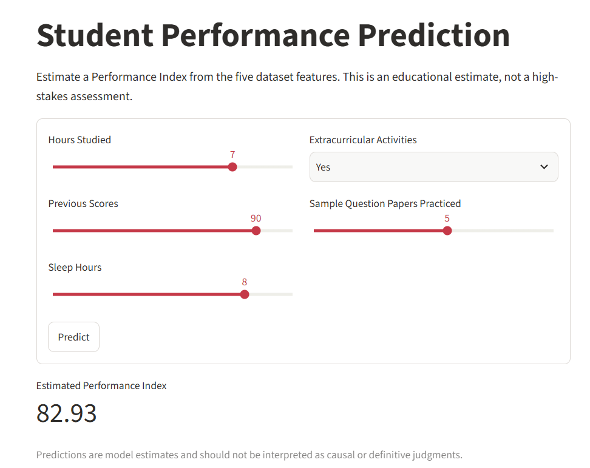
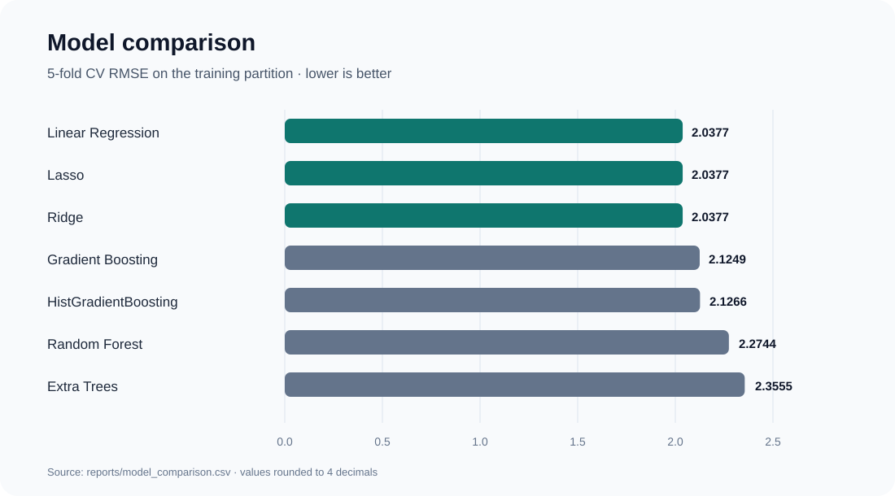
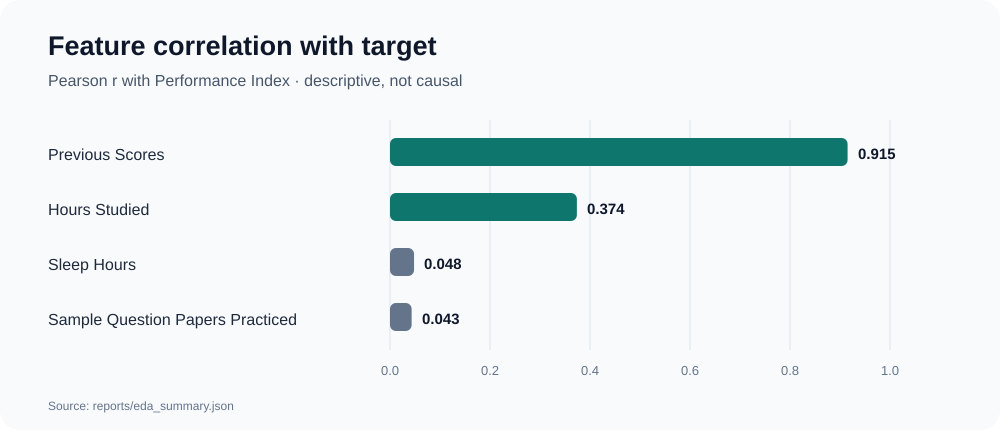

# Student Performance Prediction

A reproducible end-to-end machine-learning project that predicts a continuous **Performance Index** from five study, academic-history, and lifestyle features. The repository includes exploratory analysis, leakage-conscious preprocessing, seven-model comparison, a saved inference pipeline, a Streamlit interface, automated tests, and GitHub Actions CI.

> **Responsible use:** This is an educational tabular-regression demonstration, not a validated educational or psychometric assessment. Dataset provenance, sampling methodology, and target construction are not documented in the supplied project. Do not use predictions for admissions, grading, discipline, or other high-stakes decisions.

## Project at a glance

| Item | Details |
|---|---|
| Task | Supervised regression |
| Target | `Performance Index` |
| Dataset | 10,000 rows; 9,873 after exact-duplicate removal |
| Input features | 4 numeric + 1 categorical |
| Candidate models | 7 regressors |
| Primary model selection | 5-fold shuffled CV on the training partition |
| Final holdout | 20%, fixed `random_state=42` |
| Selected estimator | Linear Regression (current recorded training run) |
| Robustness protocol | Nested repeated 80/20 holdouts: inner CV selection, outer holdout scoring |
| Interface | Streamlit |
| Automation | GitHub Actions: Python 3.11, 3.12, 3.13 + nested robustness job |

## Live application demo

The Streamlit interface was launched locally on Windows and used to generate a sample prediction. The screenshot below documents the running application; it is a demonstration, not an independently validated assessment.



## Results

The following values are recorded in the repository's `reports/model_comparison.csv` and `models/metadata.json`. They are not estimates invented for this README.

**Selected model — Linear Regression**

| Metric | 5-fold CV (training partition) | Holdout test |
|---|---:|---:|
| MAE | 1.6185 | 1.6470 |
| RMSE | 2.0377 | 2.0751 |
| R² | 0.9887 | 0.9884 |
| MSE | — | 4.3059 |



The seven candidates are compared below. CV RMSE is computed as the square root of the mean fold MSE; CV MAE and CV R² are arithmetic means of their fold scores. The selected estimator is chosen using training-partition CV RMSE only; holdout metrics are reported for transparency and are not used to select the model.

| Model | CV RMSE | Test RMSE | Test R² |
|---|---:|---:|---:|
| Linear Regression | **2.0377** | **2.0751** | **0.9884** |
| Lasso | 2.0377 | 2.0752 | 0.9884 |
| Ridge | 2.0377 | 2.0751 | 0.9884 |
| Gradient Boosting | 2.1249 | 2.1391 | 0.9877 |
| HistGradientBoosting | 2.1266 | 2.1551 | 0.9875 |
| Random Forest | 2.2744 | 2.3016 | 0.9858 |
| Extra Trees | 2.3555 | 2.3717 | 0.9849 |

The differences among Linear Regression, Lasso, and Ridge are extremely small. The high R² must be interpreted cautiously because the dataset's target-generation process is undocumented; strong in-dataset performance does not establish external validity.

### Nested repeated-holdout evaluation

The robustness workflow now performs nested model selection rather than repeatedly evaluating a model selected earlier on overlapping data:

1. Create an outer 80/20 train/test split for each seed.
2. Compare all seven candidate estimators using 3-fold CV on the outer training partition only.
3. Fit the selected preprocessing/model pipeline on the complete outer training partition.
4. Score once on that split's untouched outer test partition.
5. Repeat for 10 deterministic outer splits (seeds 0–9).

This estimates the performance of the **model-selection procedure**, not just a fixed Linear Regression estimator. Preprocessing is inside each sklearn Pipeline and is refitted within every inner fold. Outer test observations are not used for inner selection.

The workflow uploads per-split metrics, aggregate summaries, and plots as a GitHub Actions artifact. Summary statistics include mean, standard deviation, min/max, and empirical 2.5th/97.5th percentiles. These percentiles describe the observed repeated-split score distribution; **they are not confidence intervals**, because outer holdouts overlap and their scores are dependent. See the [latest GitHub Actions runs](https://github.com/alirezahs81/student-performance-prediction/actions).

## Dataset and exploratory analysis

The supplied `data/Student_Performance.csv` contains 10,000 records and six columns:

| Feature | Meaning | Observed range / values |
|---|---|---|
| `Hours Studied` | Study hours | 1–9 |
| `Previous Scores` | Previous academic score | 40–99 |
| `Extracurricular Activities` | Participation | Yes / No |
| `Sleep Hours` | Sleep hours | 4–9 |
| `Sample Question Papers Practiced` | Number of practice papers | 0–9 |
| `Performance Index` | Continuous target | 10–100 |

The supplied file has no missing values and contains 127 exact duplicate rows. Exact duplicates are removed before splitting, leaving 9,873 unique observations. The recorded 1.5×IQR check flags no numeric outliers; no rows are removed using an outlier rule.

Selected descriptive findings from `reports/eda_summary.json`:

- `Previous Scores` has the strongest Pearson correlation with the target (r = 0.915).
- `Hours Studied` has a positive moderate correlation (r = 0.374).
- `Sleep Hours` (r = 0.048) and practice papers (r = 0.043) have weak linear correlations.
- Extracurricular participation is nearly balanced: 4,948 Yes and 5,052 No.

Correlations are descriptive, not causal. The dataset documentation supplied with this repository does not explain how the target was constructed, so possible target-generation relationships cannot be independently ruled out.



See the [EDA summary](reports/eda_summary.json) and [analysis notebook](notebooks/eda_and_model_analysis.ipynb).

### Dataset provenance and limitations

The CSV is distributed under the name `Student_Performance.csv` and is commonly associated with the [Student Performance dataset on Kaggle](https://www.kaggle.com/datasets/nikhil7280/student-performance-multiple-linear-regression). This repository does not contain a source-side data card, collection protocol, license statement, sampling frame, or explanation of how `Performance Index` was generated. The Kaggle association is therefore a traceable lead, **not independent verification of the original data provenance or licensing**. Before redistribution or real-world use, verify the source owner's terms and document the original source, license, collection process, and target definition. Some secondary educational references describe similarly named copies as synthetic; without an authoritative source statement, this project does not assert that the supplied file is confirmed synthetic.

## Methodology

1. Validate the expected feature/target schema and remove exact duplicate rows.
2. Make one reproducible 80/20 train/test split (`random_state=42`).
3. Put preprocessing inside an sklearn `Pipeline` so it is fitted only on each training fold: median imputation and standard scaling for numeric features; most-frequent imputation and one-hot encoding for the categorical feature.
4. Compare seven regressors using 5-fold shuffled `KFold` cross-validation on the training partition.
5. Select the model with the lowest mean CV RMSE and evaluate it on the untouched holdout partition. Holdout scores are not used for model selection.
6. Persist the complete preprocessing + estimator pipeline in `models/best_pipeline.joblib`.
7. Separately, use nested repeated holdouts to evaluate the entire candidate-selection procedure, with inner CV restricted to each outer training partition.

No target-informed preprocessing or feature selection is performed. No automatic outlier deletion is applied.

## Repository structure

```text
student-performance-prediction/
├── .github/workflows/ci.yml
├── data/Student_Performance.csv
├── models/
│   ├── best_pipeline.joblib
│   └── metadata.json
├── notebooks/eda_and_model_analysis.ipynb
├── reports/
│   ├── eda_summary.json
│   ├── model_comparison.csv
│   ├── model_cv_rmse.svg
│   ├── student-performance-demo.png
│   └── feature_correlations.svg
├── src/
│   ├── data.py
│   ├── pipeline.py
│   ├── predict.py
│   ├── robustness.py
│   └── train.py
├── tests/
│   ├── conftest.py
│   ├── test_project.py
│   └── test_robustness.py
├── app.py
├── requirements.txt
└── README.md
```

## Installation

Use Python 3.11–3.13. From the repository root:

```bash
python -m venv .venv

# Windows PowerShell
.venv\Scripts\Activate.ps1

# macOS / Linux
source .venv/bin/activate

python -m pip install --upgrade pip
pip install -r requirements.txt
```

The saved joblib artifact was created with scikit-learn 1.8.0. Keep the pinned scikit-learn version when loading it; pickle/joblib artifacts are not guaranteed to be compatible across arbitrary scikit-learn versions. Retrain in a different environment if needed.

## Train and evaluate

```bash
python -m src.train
```

This recreates `models/best_pipeline.joblib`, `models/metadata.json`, and `reports/model_comparison.csv` from the included dataset.

## Run nested robustness evaluation

```bash
python -m src.robustness
```

By default, this runs 10 repeated random 80/20 outer splits (seeds 0–9), with 3-fold inner CV to select among the same seven candidate models used by training. It writes per-split metrics, a summary, and two plots under `reports/`. Options include `--n-splits`, `--inner-splits`, `--random-state-start`, `--output-dir`, and `--no-plots`. Empirical score percentiles are descriptive ranges, not confidence intervals.

## Predict from Python

```python
from src.predict import predict

student = {
    "Hours Studied": 6,
    "Previous Scores": 75,
    "Extracurricular Activities": "Yes",
    "Sleep Hours": 7,
    "Sample Question Papers Practiced": 4,
}

print(predict(student)[0])
```

The inference function requires exactly the five feature names, accepts only `Yes` or `No` for the categorical feature, rejects non-finite/non-numeric values, and restricts numeric inputs to the inclusive ranges observed in the supplied dataset.

## Run the Streamlit application

```bash
streamlit run app.py
```

The app uses the same saved pipeline and feature schema as the Python prediction function. Train first if the model artifact is missing.

## Tests and continuous integration

Run tests locally:

```bash
python -m pytest -q
```

The GitHub Actions workflow at `.github/workflows/ci.yml` runs the test suite on Python 3.11, 3.12, and 3.13 for pushes, pull requests, and manual dispatch. A separate Python 3.12 job runs the nested repeated-holdout evaluation and uploads its reports as an Actions artifact. This workflow runs automatically on pushes; no manual dispatch is required for these changes.

[View GitHub Actions](https://github.com/alirezahs81/student-performance-prediction/actions)

## Limitations and next steps

- Dataset provenance, sampling design, licensing, and target construction remain unverified.
- No external validation dataset was supplied; performance is measured within this dataset's distribution.
- Nested repeated holdouts reduce model-selection optimism within each split, but overlapping outer test partitions mean the resulting split-level metrics are dependent.
- Empirical percentiles are not inferential confidence intervals.
- The high in-dataset R² does not establish causal relationships or generalization to other student populations.
- The saved model is tied to its training feature schema and library version.
- The app is a demonstration, not a substitute for educator judgment or validated assessment.

Potential future work includes obtaining a documented independent dataset, verifying its license and provenance, defining a pre-registered evaluation protocol, and assessing subgroup performance and calibration before considering any real-world educational use.
